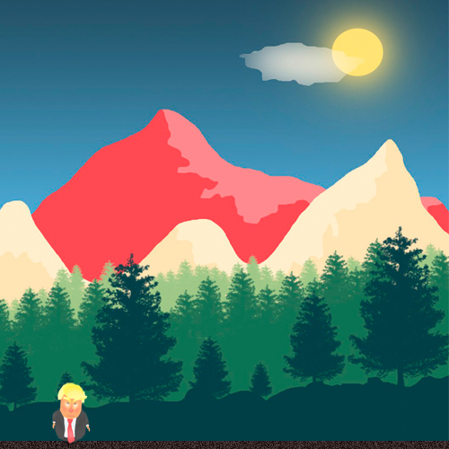

# Trump PyGame (2020)

[English](README.md) | [Русский](README.ru.md)

Небольшая 2D-игра на Python и Pygame. Персонаж с анимацией ходьбы перемещается по сцене, прыгает и стреляет.

Учебный проект для практики обработки клавиатуры, анимации спрайтов и игрового цикла. Код игры находится в [app/game.py](app/game.py), фон и спрайты персонажа — в [images/](images/).



## Игровые возможности

- Движение влево и вправо с анимацией из шести кадров для каждого направления.
- Прыжок по нажатию пробела.
- Стрельба в сторону последнего движения, до пяти снарядов на экране одновременно.
- Окно 500 × 500 и игровой цикл с ограничением до 30 кадров в секунду.

## Управление

| Клавиша | Действие |
| --- | --- |
| `←` | Двигаться влево |
| `→` | Двигаться вправо |
| `Space` | Прыгать |
| `F` | Выпустить снаряд |
| Закрыть окно | Выйти из игры |

## Локальный запуск

Нужны Python 3.12 и графический сеанс, в котором Pygame сможет открыть окно. Команды ниже рассчитаны на Bash и устанавливают Pygame 2.6.1 в виртуальное окружение.

```bash
git clone https://github.com/ivan-zamula/trump-pygame-2020.git
cd trump-pygame-2020
python3 -m venv .venv
source .venv/bin/activate
python -m pip install pygame==2.6.1
python app/game.py
```

Для повторного запуска активируйте то же окружение и выполните `python app/game.py` из корня проекта.

## Файлы проекта

| Путь | Назначение |
| --- | --- |
| [app/game.py](app/game.py) | Обработка ввода, движение, прыжки, анимация, снаряды и отрисовка |
| [images/bg.jpg](images/bg.jpg) | Фоновое изображение |
| [images/idle.png](images/idle.png) | Спрайт стоящего персонажа |
| [images/gameplay.png](images/gameplay.png) | Скриншот игры |
| [images/](images/) | Кадры ходьбы: `left_1.png`–`left_6.png` и `right_1.png`–`right_6.png` |

Пути к изображениям вычисляются относительно самого скрипта, поэтому загрузка ресурсов не зависит от текущего рабочего каталога.

## Как устроена игра

На каждом кадре считывается состояние клавиатуры, обновляются координаты персонажа и снарядов, затем перерисовывается сцена. При ходьбе меняются шесть спрайтов; после отпускания клавиш движения отображается стоящий персонаж. Траектория прыжка задается простым счетчиком. Снаряды движутся горизонтально и удаляются при выходе за границы окна.

Для путей к ресурсам используется модуль Python `pathlib`, а для окна, ввода, загрузки изображений, отрисовки и времени кадра — Pygame.
